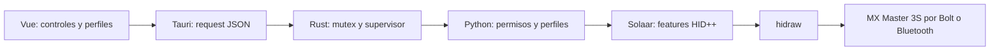

# Arquitectura y decisiones

**Estado vigente, 27 de octubre de 2026:** el paquete usa el backend Rust nativo;
Python/Solaar queda como ruta de desarrollo heredada. La historia N1–N5 que sigue
documenta etapas anteriores y no implica que la GUI empaquetada siga usando Python.
La edición guarda automáticamente Perfil actual, Guardar como crea copias locales
y la carga al abrir/reconectar no requiere una casilla. Este contrato sustituye
las referencias anteriores a guardar manualmente y habilitar reaplicación:
[perfil actual, costes y fallos](automatic-profiles.md).

La bandeja optativa también controla el arranque: ventana inicialmente oculta,
espera acotada del panel y ventana de respaldo si falla. El sondeo Rust continúa
con la ventana oculta; un segundo inicio muestra la instancia existente.
[Contrato y aceptación pendiente](desktop-lifecycle.md).

## ADR-001: backend híbrido inicial

Estado: implementado como transición. ADR-002 sustituye la decisión de mantener
Solaar como solución final; las secciones de módulos actuales describen el código
existente, no la arquitectura objetivo.

Se conserva el stack solicitado. Rust mantiene la frontera IPC de Tauri y la
supervisión de procesos; un proceso Python residente y aislado usa la implementación HID++
de Solaar instalada por el sistema. Ventajas: soporte real de Bolt/Bluetooth,
descubrimiento de features, validadores y errores de transporte ya mantenidos.
Costo: dependencia Python y API interna de Solaar sin estabilidad contractual.
Versión probada: 1.1.20. No se copia código GPL ni se modifica el paquete instalado;
el producto adopta GPL-3.0-or-later, compatible con GPL-2.0-or-later de Solaar.

Implementar hidraw/HID++ directamente en Rust requeriría multiplexación de respuestas,
software IDs, timeouts, receptor versus dispositivo directo y notificaciones.
Se implementará por etapas detrás del contrato existente, según ADR-002. logid aporta acciones,
gestos y D-Bus, pero su despliegue habitual es privilegiado, necesita configuración
propia y no está instalado aquí. No se lo habilita como segundo controlador.

## ADR-002: backend nativo propio obligatorio

Decisión del 19 de octubre de 2026, a partir del rechazo del usuario a depender de
Solaar: Linux ScrollMaster debe controlar el dispositivo con transporte hidraw e
implementación HID++ propios en Rust. La migración deja de ser una opción
condicionada a ventajas futuras y pasa a ser la prioridad de desarrollo.

Objetivo final: ejecución y paquete sin Solaar ni Python, incluidas reglas de acceso
al dispositivo propias y acotadas. Se conservan interfaz, contratos, perfiles y
preferencias. El backend actual sigue operativo durante la transición; no se
presentará como independiente hasta cumplir los criterios de aceptación.

Un único backend y un único lector controlan cada dispositivo. No habrá fallback
silencioso a Solaar. Las etapas comienzan con transporte y diagnóstico de solo
lectura, sin reaplicación automática ni diversion; escrituras y eventos se habilitan
solo tras implementar confirmación, cancelación y recuperación.

Alcance, orden, permisos y criterios de retirada: [backend nativo](native-backend.md).

N1 implementado el 20 de octubre de 2026 como biblioteca Rust aislada: transporte
hidraw directo, codec, errores, plazos monotónicos y sesión con un propietario.
Las pruebas usan vectores sintéticos documentados y sockets locales; no se activa
al iniciar la GUI. Los siguientes pasos siguen siendo descubrimiento/lecturas,
escrituras, recuperación, integración y retirada de dependencias. Inventario del
contrato, elección del transporte y límites: [N1](native-transport.md).

N2 añade `src-tauri/src/native/` y el ejemplo `native_diagnostic`: enumeración
pasiva de interfaces Bolt, apertura validada con metadata/ioctl, lease compartido
y diagnóstico de getters en un proceso supervisado. No carga perfiles ni se
conecta al worker Tauri. Dos diagnósticos Bolt confirmaron identidad y seis valores
en hardware, tras localizar el slot 2 y validar el modelo BLE B034. Contrato,
consultas y límites: [N2](native-diagnostic.md).

N3 añade `native/settings.rs` y el ejemplo separado `native_settings`: seis setters
con identidad esperada, lote validado antes de escribir y confirmación sin caché
por el mismo lector. Conserva bits de reporting y explicita errores parciales.
No carga/desarma perfiles ni se conecta a la GUI; esa paridad corresponde a N5.
Roundtrip DPI/restauración aceptado en hardware: [ajustes nativos](native-settings.md).
`native/buttons.rs` añade catálogo 1B04 y remapeo de CIDs 83/86/195; valida
grupos y reporting antes de cada setter y confirma por lectura en la misma sesión.
`native_buttons` es una herramienta aislada, sin perfiles ni IPC Tauri. Su roundtrip
Atrás→Adelante→Atrás está aceptado; no activa diversion. La aceptación ampliada
sigue pendiente: [contrato y evidencia](native-button-remapping.md).

N4 inicia `native/events.rs` y el ejemplo aislado `native_events`: decodificación
1B04, flancos y raw XY con contexto, colección acotada/cancelable por el mismo
lector. Solo getters y recepción pasiva; no hay activación de reporting ni acciones.
Una escucha real de 1000 ms sin eventos pasó. Los getters y las escrituras internas
sobre sesión prestada ya conservan informes intercalados, en una FIFO de 128 con
cierre por desbordamiento. El observador procesa primero los pendientes del setup
y los identifica en la salida. `ReportConsumer` permite entrega síncrona durante
consultas y confirmaciones, sin otro lector, con comprobaciones de salud/cancelación
y cierre ante fallo o panic. El observador usa esa vía para la cola inicial y el
reposo. `native/owner.rs` incorpora `PassiveEventOwner`: propietario acotado con
refresh de solo lectura, validación de identidad/configuración y cierre terminal
sin reabrir. Una segunda consulta con consumidor y 5001 ms de escucha en reposo
pasaron en Bolt. La inicialización del propietario también admite cancelación durante getters,
conservando la FIFO hasta validar identidad/capacidades, con esperas de hasta 50 ms.
`native/recovery.rs` incorpora registro validado y limpieza confirmada de flags
temporales; no habilita diversion ni ejecuta acciones y todavía no tiene proceso
guardián o handoff propios. Contrato: [restauración](native-recovery.md).
`native/guardian.rs` ahora integra ambos en un proceso que abre y conserva descriptor
más lease durante preparación, observación y recuperación. El cliente solo tiene
IPC validado de estado/refresh/cierre: no hay herencia HID, segundo lector ni handoff
entre procesos. La sesión activa toma un préstamo léxico que termina antes de la
restauración. EOF/fallos/panics disparan cierre y restauración sin matar al hijo;
el cliente recoge su salida. Pruebas con SIGKILL del cliente usan mouse sintético.
[Guardián y límites](native-guardian.md). `native/keyboard.rs` ya enlaza el C propio
estáticamente, con tipos cerrados y cierre único. `native/wayland_wait.c` limita
confirmaciones con un plazo absoluto de 2 s por operación. El guardián admite
comprobación optativa en estado cero y libera teclado antes de restaurar reporting,
aun con errores de salida. [Teclado, limpieza y límites](native-keyboard.md).
`native/actions.rs` implementa el motor aislado de flancos, modificadores y gestos,
con salida al teclado tipado, supresión de botones mantenidos, cancelación y DPI.
`events::EventSink` conecta el motor al consumidor único, con eventos tipados y
cierre compartido mediante `SinkHandle`. El setup no entrega su FIFO al motor;
las consultas conservan el recorrido físico provisional y retienen sus acciones
hasta validar identidad/configuración y confirmar los mismos DPI; un cambio real
descarta ese recorrido. [Corrección del sondeo](gesture-polling.md). El guardián prepara
ese motor con asignaciones vacías en `--keyboard-check`; los fixtures sí inyectan
acciones y prueban su cierre antes de restaurar. [Entrega, evidencia y límites](native-action-delivery.md).
`native/activation.rs` añade captura optativa en el guardián, con registro opaco de
recuperación, salida bloqueada durante activación, validación antes de cada setter,
ACK y lectura posterior/final. Solo después se arma salida y se anuncia `ready`.
La configuración se fija al arrancar; no hay setters genéricos ni reasignación por
IPC. La sincronización no usa historial anterior al último setter.
`native/desktop.rs` aporta las cuatro acciones Hyprland con catálogo tipado,
preflight de versión/Lua antes de captura y en cada acción, sockets no bloqueantes
con plazo absoluto y sin reintento incierto. El motor enruta teclado y escritorio
por separado y cierra salida ante fallo, antes de restaurar reporting.
[Escritorio nativo, evidencia y límites](native-desktop.md).
[Captura, evidencia y límites](native-capture.md). Aceptación física pendiente:
[recepción](native-events.md) y [propietario](native-owner.md).

N5 añade `src-tauri/src/profiles/` como núcleo separado de validación, gestión
local, selección pura de perfil efectivo y persistencia. Conserva schemas 1–10
y metadatos; no migra al leer ni importa activaciones/reglas externas. La revisión
opaca y el lock cooperativo nativo previenen escrituras con estado antiguo;
publicación sin confirmar tiene un error distinto de fallo previo al rename.
`native_profiles` valida/calcula JSON por stdin/stdout sin guardar ni aplicar.
No se conecta todavía al worker Python: la transición deberá mantener un único
escritor de perfiles y propietario HID. [Contrato, evidencia y continuidad](native-profiles.md).
`service.rs` ya coordina guardado, desarmado previo y reconciliación por petición
con `NativeProfileBackend` sobre una única `Session<T>`. Valida el perfil completo
antes del primer setter y confirma conjuntamente al terminar. El adaptador admite
ajustes/remapeos nativos y rechaza software hasta integrar el ciclo de vida del
guardián. `NativeProfileOwner` ya aporta construcción offline, conexión diferida,
lease y descubrimiento nuevo tras fallos. Conserva Unit ID/slot explícitos, exige
una interfaz Bolt sin ambigüedad y destruye la sesión antes de liberar el lease.
Cada apply requiere preflight en la misma sesión/petición; nunca reconecta ni
repite una escritura fallida. `worker.rs` y `scrollmaster-native-worker` ya ofrecen
JSON-lines experimental en un proceso separado, con operaciones cerradas y cierre
al EOF/shutdown. `bridge.rs` es ahora biblioteca compartida por el host y las
pruebas; limita envío/respuesta con un único plazo y recoge al hijo tras fallos.
`native/focus.rs` ya usa ese transporte para leer clase activa y catálogo de
aplicaciones, sin dispatchers ni datos de títulos/PID. El worker consulta foco
en cada snapshot, lo entrega al servicio y adjunta la descripción de escritorio;
`applications` devuelve catálogo/perfiles sin abrir HID ni reconciliar. No se
acepta foco por IPC y un fallo regresa al perfil general. La GUI sigue iniciando
Python; acciones duraderas del guardián y sustitución del worker Tauri siguen pendientes.
[Protocolo](native-worker.md) y [foco, evidencia y límites](native-focus.md).
[Servicio](native-service.md) y [dueño, evidencia y límites](native-profile-owner.md).

`native/profile_buttons.rs` ya compila los mapas persistidos en remapeos nativos
y asignaciones software separados. `guardian_config.rs` construye captura finita
solo para estas últimas y conserva los destinos nativos como requisitos de la
sesión fresca. El guardián comprueba esos destinos antes de activar y al confirmar;
su activación revalida el catálogo completo entre setters. Ready conserva el mapa
original, contrastado por el padre. No aplica ajustes/remapeos ni arma perfiles.
Esta ruta optativa por CLI no conecta todavía el servicio duradero ni habilita
software en `NativeProfileOwner`. [Contrato y evidencia](native-profile-actions.md).

`ProfileGuardianOwner` ya implementa `ProfileBackend` como proxy de un propietario
persistente independiente, seleccionado mediante `--serve-guarded`. El padre
conserva la única escritura de perfiles; el hijo abre y conserva sesión/lease.
El RPC privado valida secuencia, tipos y vencimiento monotónico absoluto; prepare
autoriza un solo apply del mismo lote/plazo sin reconectar entre ambos. Ante
fallos se cierra IPC sin matar al propietario, y no se inicia otro desde el mismo
proxy hasta recoger el anterior. El cierre explícito del servicio espera acuse y
recogida antes de stopped. Todavía solo aplica ajustes/remapeos nativos; motor/salida
y restauración de reporting pendientes en este dueño duradero.
[Contrato, pruebas y límites](native-profile-guardian.md).

## Módulos actuales

| Capa | Código | Responsabilidad |
|---|---|---|
| Interfaz | `src/App.vue`, `src/style.css` | Presentación, ilustración original, accesibilidad básica, selección visual |
| Estado / cliente | `src/device.ts`, `src/deviceState.ts` | Eventos nativos, estado reactivo, revisión de respuestas y selección de dispositivo |
| Host | `src-tauri/src/main.rs` | Comando request para hardware, serialización fuera del runtime async, worker JSON-lines, timeout 45 s, salida por respuesta acotada 2 MiB |
| Biblioteca nativa experimental | `src-tauri/src/hidpp/`, `src-tauri/src/lib.rs` | N1: codec, sesión correlacionada, cola acotada y E/S hidraw propia; sin conexión al worker activo |
| Servicio | `bridge/service.py:handle` | Operaciones permitidas, perfiles, reconciliación, mensajes |
| Adaptador | `bridge/solaar_adapter.py:SolaarBackend` | Enumeración, features, lectura/escritura, validación, confirmación, cierre de handles |
| Persistencia | funciones de perfiles en `bridge/service.py` | JSON versión 1–10, ruta XDG propia, archivo temporal 0600, fsync y reemplazo atómico |
| Perfiles Rust experimentales | `src-tauri/src/profiles/` | Modelo/gestión local, revisión y persistencia confirmada; todavía sin conexión al worker activo |
| Servicio Rust experimental | `src-tauri/src/service.rs`, `src-tauri/src/native/profile_backend.rs` | Guardado, desarmado y reconciliación nativa por petición; sin sustituir el worker de la GUI |
| Dueño Rust experimental | `src-tauri/src/native/profile_owner.rs`, `profile_connector.rs` | Apertura diferida, lease/controladores, identidad y reconexión entre peticiones; una sesión y ningún reintento interno |
| Worker Rust experimental | `src-tauri/src/worker.rs`, `src-tauri/src/bin/scrollmaster-native-worker.rs` | Peticiones JSON-lines cerradas, servicio persistente en proceso separado; sin selección desde la GUI |
| Foco Rust experimental | `src-tauri/src/native/focus.rs` | Clases de aplicación desde dos consultas fijas, sesión resuelta por petición, presupuesto único y sin caché |
| Supervisor compartido | `src-tauri/src/bridge.rs` | Python activo o lanzamiento Rust explícito, pipes acotados, plazo de envío/respuesta y kill/wait terminal |
| Motor de acciones | `bridge/modifiers.py`, `bridge/actions.py` | Alt/Ctrl y edición en laterales, flancos, liberación y gestos en `bridge/gestures.py` |
| Escritorio | `native/keyboard.c`, `bridge/desktop.py` | Teclado virtual Wayland; foco y catálogo fijo de espacios/ventanas Hyprland; otros compositores pendientes |

## Contrato y flujo

`request({op, device?, changes?, name?})` admite snapshot/set/remap/save/restore/auto.
Devuelve `{ok,data}` o `{ok:false,error}`. `device` usa Unit ID o serial estable,
no un número de slot ni un texto ambiguo. La GUI nunca pasa ejecutables, comandos
shell, nombres de scripts o rutas de configuración al host.

El adaptador consulta seis settings explícitos; si no puede construir o leer uno,
no se habilita su control. DPI usa exclusivamente las opciones anunciadas.
Se valida el lote completo antes de escribir. La operación no es transaccional:
si falla una escritura posterior, las anteriores pueden estar aplicadas y el error
lo indica. Se exige lectura sin caché tras cada cambio. Modo de giro precede a
SmartShift para evitar su lectura marcador en freespin.

El hook de persistencia de Solaar se desactiva **dentro del proceso hijo**. No se
adjunta ni guarda su configuración. El proceso JSON-lines conserva el adaptador y sus capacidades, comprueba conectividad
y reabre handles tras desconexión. Los ajustes siempre se leen sin caché. Ante timeout
o protocolo inválido, Rust finaliza y recoge el hijo y lo reinicia en la siguiente
consulta. Al cerrar normalmente la aplicación se cierra también el proceso hijo.
Alt/Ctrl habilitan diversion temporal solo en los laterales, con consumidor único
y guardián de recuperación. Los gestos habilitan raw XY temporal exclusivamente en CID 195, con confirmación y recuperación; no se desvían las ruedas.

## Reconexión, suspensión y perfiles

Rust sondea cada 5 s después de terminar la consulta anterior. No depende de
los temporizadores del webview y sigue activo al minimizar mientras el proceso de
Linux ScrollMaster esté abierto. Las solicitudes manuales y el sondeo comparten mutex; cada
respuesta (incluidos errores) recibe una revisión monotónica dentro del bloqueo.
Vue descarta respuestas anteriores, conserva la identidad seleccionada si el mouse
se desconecta e invalida controles ante error hasta recuperar una lectura válida.

Si el usuario habilita un perfil, snapshot compara lecturas reales y escribe solo
diferencias. Retorna los nombres de los ajustes realmente escritos y confirmados;
no confunde ausencia de cambios con una reaplicación efectiva. Se puede armar o
desarmar un perfil guardado con el mouse desconectado. La recuperación tras suspensión
se verificó físicamente con el usuario: la lógica compara el estado aun sin haber
observado un evento de desconexión. Las operaciones tienen timeout de 45 s de tiempo
activo; un sondeo ya iniciado al suspender puede retrasar la recuperación hasta terminar.

Antes de editar manualmente o restaurar un perfil, se desarma la reaplicación en disco.
Si el disco falla, no se escribe en el hardware. Si la escritura falla parcialmente,
ningún perfil antiguo se reactiva para contradecirla. Restaurar no habilita automática:
el usuario marca la casilla expresamente. Guardar exige lecturas de los seis ajustes
MVP; no sobrescribe el perfil con una lectura parcial. El modelo persistido se valida
independientemente del adaptador en `bridge/model.py`.

La elección sobrevive al reinicio de Linux ScrollMaster. No se instala un servicio; el inicio
automático XDG es voluntario y separado de los perfiles. Al cerrar el proceso deja
de reconciliar. Pruebas físicas y aceptación GUI actuales
en [reliability-milestone.md](reliability-milestone.md).

## Permisos y concurrencia

Interfaz y servicio como usuario normal. Reutiliza reglas hidraw de Solaar;
no necesita evdev, uinput, sudo, polkit ni configuración del compositor para estos
seis ajustes. `flock` por usuario serializa instancias propias; Rust serializa el IPC.
Se comprueban procesos Solaar/logid antes de toda operación, sin terminarlos.
No es un bloqueo del dispositivo contra procesos no cooperativos: existe una carrera
si otro controlador arranca durante una operación o se oculta tras otro nombre.

El adaptador interno queda aislado con contrato v1 y lista explícita de versiones
probadas (`SUPPORTED_SOLAAR`); solo él importa Solaar. Se restaura el hook de persistencia
al salir del contexto, incluso con errores de enumeración. No se crean capas vacías
que aparenten un motor de acciones implementado.

## Compatibilidad gráfica

El inicio Rust aplica el workaround de DMA-BUF solo en Wayland con NVIDIA y sin
override explícito. Fue necesario en este host (Error 71); queda dentro del proceso
y se ejecuta antes de crear la aplicación. No se modifican archivos de Hyprland.

## Incremento de asignaciones nativas de botones

El adaptador añade catálogo de botones y reporting sin caché; `remap` reasigna
funciones nativas del firmware a controles secundarios. No consume ni desvía
eventos. Los clics principales no se pueden modificar. Perfiles schema 2 guardan
asignaciones reales; perfiles schema 1 siguen restaurando solo sus seis ajustes.
Detalles, limitaciones y pruebas: [native-buttons.md](native-buttons.md).

## Modificadores mantenidos

`bridge/modifiers.py` calcula máscaras Alt/Ctrl a partir del conjunto real de CIDs
mantenidos. `NotificationHandle` entrega al mismo consumidor tanto informes idle
como los encontrados durante solicitudes. El worker conserva su lease mientras
hay modificadores y procesa eventos entre comandos, sin un segundo lector HID.

Un proceso guardián crea el teclado virtual Wayland usando la biblioteca propia
compilada de `native/keyboard.c`. Registra los controles antes de desviar; ante EOF
libera teclado y restaura reporting con su descriptor heredado. Recuperación normal
y tras SIGKILL verificadas en hardware. Schema 3 guarda acciones tipadas; schemas
1/2 siguen válidos. Alcance, límites y evidencia: [held-modifiers.md](held-modifiers.md).

## Acciones de edición

El catálogo cerrado `bridge/actions.py` añade Copiar/Pegar/Cortar/Deshacer. El
motor detecta el flanco de pulsación y el guardián envía la combinación completa
en Wayland, restaurando modificadores previos. Schema 4 preserva documentos 1/2/3.
Errores del consumidor idle se conservan en warnings del siguiente snapshot.
Detalles y aceptación física: [button-shortcuts.md](button-shortcuts.md).

## Gestos direccionales

Schema 5 guarda la configuración dentro del botón 195. El motor puro consume raw XY
y ejecuta una acción al soltar. El guardián también restaura RAW_XY. Editor visual y
contrato documentados en [directional-gestures.md](directional-gestures.md); aceptación
física pendiente.

## Reglas por aplicación

Schema 6 añade reglas opcionales con referencias validadas a perfiles. El perfil
general armado habilita el automatismo; el adaptador Hyprland aporta foco de solo
lectura y el servicio resuelve el perfil efectivo sin cambiar la selección global.
Editar manualmente desarma ambos. Importar no instala reglas. Ver
[application-profiles.md](application-profiles.md).

## Ciclo de escritorio

`instance.rs` mantiene la exclusión por sesión antes de crear GUI/worker; su IPC
solo recupera la ventana existente. `lifecycle.rs` administra la bandeja optativa,
preferencias propias y cierre frente a salida. `autostart.rs` añade una entrada XDG
voluntaria sin daemon ni cambios de sesión durante desarrollo. Detalles
y límites en [desktop-lifecycle.md](desktop-lifecycle.md).

## Multimedia

`ACTIONS` une edición y multimedia para el motor de gestos y el guardián. Los
laterales siguen limitados a edición/modificadores. Salida C validada por tecla
y máscara, sin API de comandos. Schema 7 y detalles: [media-gestures.md](media-gestures.md).

## Distancia física de gestos

Schema 8 añade unidades explícitas, sin migrar perfiles antiguos. El motor puro
convierte décimas de mm a cuentas usando DPI reales; el adaptador sincroniza la
escala tras lecturas y escrituras confirmadas. Cambio durante pulsación cancela;
pérdida de lectura detiene captura y devuelve botones. La GUI concentra conversión
y presentación en `src/gestureDistance.ts` y `GestureEditor.vue`. Contrato, límites
y evidencia: [gesture-distance.md](gesture-distance.md).

## Atajos personalizados

Schema 9 añade combinaciones de una tecla con Ctrl/Alt/Shift/Super en laterales y
gestos. Catálogo y parser canónico en `bridge/actions.py`; se anuncia según
capacidades del control. Vue separa selector, editor de combinación y borrador de
asignación; editar no escribe. Se reutilizan IPC, consumidor y guardián existentes.
C valida teclas y máscaras, confirma pulsación/liberación y restaura la máscara
anterior; su cierre conserva la liberación de teclas pendientes. No hay comandos,
captura global, repetición ni macros. La salida conserva el keymap US propio y no
se traduce según el teclado físico. Contrato, pruebas y aceptación pendiente en
[custom-shortcuts.md](custom-shortcuts.md).

## Acciones de escritorio

Schema 10 añade cuatro acciones Hyprland en laterales y gestos. El catálogo fijo
de `actions.py` distingue salida de teclado de dispatchers Lua. `desktop.py` valida
versión/capacidades con lecturas y una expresión fija sin efectos, y abre una nueva
conexión por petición. El guardián ejecuta estas acciones sin pasar por el teclado
C y conserva recuperación ante cualquier error. No hay API genérica de Lua/shell.
La GUI conserva selectores y deshabilita acciones cuando falta soporte; el backend
revalida antes de diversion y al ejecutar. Un timeout no se reintenta. Detalles,
plazos, versiones y aceptación pendiente en [desktop-actions.md](desktop-actions.md).

## Inicio automático XDG

`autostart.rs` deriva ruta y ejecutable internamente; IPC solo acepta habilitar o
deshabilitar. Trabaja en spawn_blocking fuera del mutex HID y valida su formato
canónico antes de tocar una entrada existente. La entrada es la fuente de verdad;
no cambia perfiles ni bandeja. Vue separa el cliente de preferencias y el control
visual de autostart, espera lecturas confirmadas y recupera el estado tras fallos.
La sesión gráfica debe procesar XDG; no se instala un servicio ni se modifica el
compositor para suplirlo. Contrato, límites y pruebas: [autostart.md](autostart.md).

## Consumidor de perfiles duradero

`native/profile_events.rs` adjunta el decoder compartido a la sesión validada y
conserva un anillo de 64 eventos con secuencia, fase y contadores de descarte.
El FIFO previo se marca como inicialización; ninguna entrega produce acciones.
`NativeProfileBackend` valida layout tras cada consulta y cierra la sesión ante
fallos, con presupuesto de 4096 informes por operación. El catálogo solo nativo
no exige capacidades de diversion; la captura finita conserva su validación estricta.

El servidor guardado alterna IPC y poll de hasta 50 ms sobre ese mismo lector,
sin adquirir hardware si sigue offline. Un flujo ocupado no posterga IPC, y
el vencimiento de tramas parciales sigue siendo absoluto. El dueño cierra lector
antes de lease ante error idle; el servidor lo entrega en orden una sola vez,
sin ejecutar esa petición o reconectar. Se invalida cualquier ticket preparado.
El conector guardado comprueba el peer también durante inicialización y E/S.
No hay reconciliación/foco autónomos ni salida/ReportingRecovery duraderos todavía.
[Contrato, evidencia y límites](native-profile-events.md).

## Captura residente optativa de perfiles

`--serve-guarded-capture` añade `GuardedProfileBackend` dentro del mismo dueño
independiente, con motor/salida preparados durante preflight y ticket para el mismo
lote/plazo. Reutiliza el consumidor, bloquea acciones durante activación y sincroniza
solo desde un estado posterior al último setter. Antes de armar salida confirma
todos los valores nativos pedidos. Los snapshots identifican la asignación software
del propietario y conservan el reporting físico como evidencia independiente.

El descriptor original se retiene en un contenedor privado con un único token
lector no clonable. Se libera salida y se destruye la sesión activa antes de
transferir el descriptor a ReportingRecovery; el lease termina después. Esto
permite recuperar incluso si la sesión activa se invalidó, sin reapertura ni otro
lector. El registro se conserva antes del primer setter de captura. Un fallo al
liberar teclas nunca salta la restauración del mouse. Los errores de close son
persistentes; el servidor exige close confirmado antes de `stopped`.

El plan de botones queda fijo hasta cierre; se permiten el mismo plan y cambios
escalares, pero otro plan se rechaza y restaura el anterior. No hay transiciones
de perfil/foco, reconexión automática de captura ni integración Tauri. Los modos
anteriores mantienen su política nativa. La evidencia de esta ruta es sintética,
incluidos procesos reales/EOF/SIGKILL del cliente; no es aceptación física.
[Contrato y límites actuales](native-profile-capture.md).
